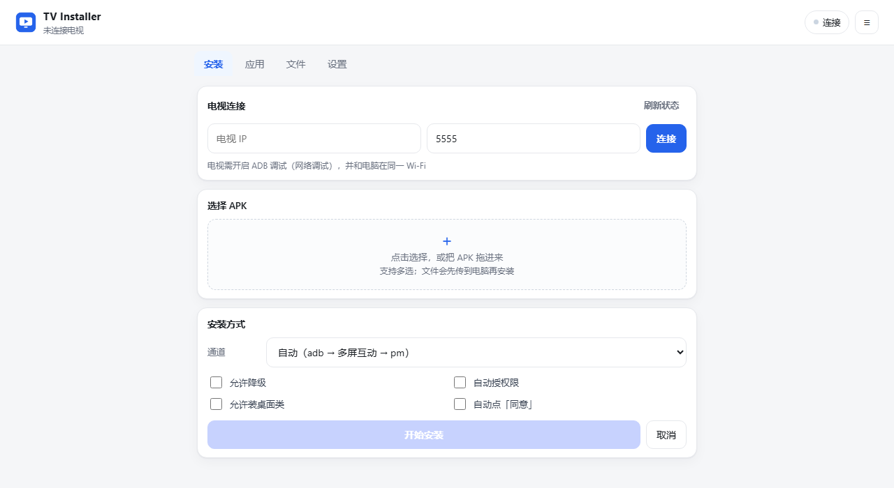
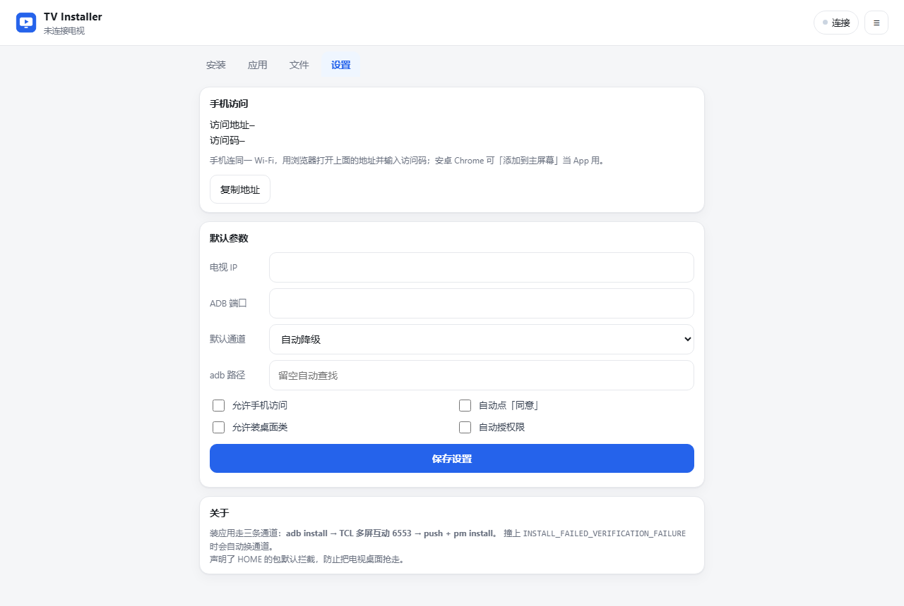

# TV Installer

**English** | [简体中文](README.zh-CN.md)

A local web UI for sideloading APKs onto Android TV and TV boxes. Start it, drag an APK onto the page, done — **zero third-party dependencies** (Python 3.8+ standard library plus the `adb` already on your machine).

## Why this exists

Chinese-market TVs (TCL, FFALCON and friends) customise the system package installer. An install request first hits the verifier in `com.android.packageinstaller`, then gets evaluated against a vendor policy chain (`InstallConfig` on TCL), strategy by strategy. APKs that declare `HOME`, are signed differently from the current launcher, or land on a blacklist are rejected on the TV with *"Install blocked"* — the error surfaces as `INSTALL_FAILED_VERIFICATION_FAILURE`.

Open-source alternatives (couchkit, Android-TV-Desktop-Toolkit, …) are essentially *`adb install` with a UI*. adb does bypass the chain, so they are fine for ordinary apps. But once adb itself is unavailable — signature conflict, aborted streaming install, a TV that only exposes the vendor push channel, or a phone with no cable — they have no fallback at all. This project ships three install channels with automatic degradation, turning "I can't install it at all" into "slower, but it works".

## Screenshots

<p align="center"></p>

<p align="center"></p>

> These are the real UI served by `python server.py` (1280 px wide, idle state with no TV connected). Desktop and phone share the same page; below 820 px the tab bar moves to the bottom.

## Features

| Module | What it does |
|---|---|
| Install | Drag-and-drop / multi-select APKs, batched queue, live log over SSE, automatic detection of **fresh install / update / downgrade / reinstall** |
| Channels | `adb install` → TCL Multi-Screen 6553 → `push + pm install`, with automatic fallback on failure and manual override |
| Apps | List third-party apps (version, update time), launch, force-stop, clear data, uninstall, export the APK back to your computer |
| Files | Browse TV directories, upload, download, rename, delete, create folders, and **install an APK that already lives on the TV** |
| Settings | Default IP / port / channel, adb path, auto-accept on the TV, allow launcher-class APKs, LAN access toggle |

## Quick start

### Prerequisites

1. **Python 3.8+** (on Windows, tick *Add Python to PATH* during setup)
2. **adb** (Android Platform Tools). Install [Android SDK Platform-Tools](https://developer.android.com/studio/releases/platform-tools) or reuse an existing adb:
   - already on `PATH` → detected automatically
   - `ANDROID_HOME` / `ANDROID_SDK_ROOT` set → detected automatically
   - neither → paste the full path to `adb.exe` under **Settings** in the UI

> **`aapt2` is not optional — please install it.** It does more than read package names and versions: the launcher-class guardrail depends entirely on it to detect `category.HOME`. Without `aapt2` the parse degrades and that guardrail **silently fails open** (a second launcher gets installed with no warning at all).
>
> The Android SDK ships it at `build-tools/<version>/aapt2.exe`, so no extra setup is needed; you can also install just that piece with `sdkmanager "build-tools;34.0.0"`. To check: start the server and look at the `aapt` field of `/api/state` — it should not be empty.

### Prepare the TV

1. Put the TV and the computer on the **same Wi-Fi**
2. Enable developer options: Settings → About → tap *Build* 5–7 times
3. Turn on **ADB debugging / network debugging** (the name varies by model)
4. Note the TV's IP: Settings → Network → current connection

### Run

```bash
# Windows: just double-click
start.bat

# or run it manually
python server.py
```

Your browser opens `http://127.0.0.1:8770/` automatically. Enter the TV IP → **Connect** → drop an APK into the dashed box → **Start install**.

Useful flags:

```bash
python server.py --port 8780     # when the port is taken
python server.py --local         # listen on 127.0.0.1 only (default)
python server.py --no-browser    # don't open the browser
```

## The three install channels

| Channel | How it works | Goes through the TV's install check? | Typical use |
|---|---|---|---|
| `adb` | `adb install -r [-d] [-g]` | **No** — the shell submits the session directly, the verifier never fires | First choice, the vast majority of third-party apps |
| `tcast` | TCL Multi-Screen (`com.tcl.MultiScreenInteraction_TV`, TCP 6553) + `adb reverse` + a local HTTP server the TV pulls from, auto-tapping *Allow* on screen | **No** — Multi-Screen shows its own consent dialog and installs the file itself, no `PackageInstaller` session | Fallback when adb is unavailable |
| `pm` | `adb push` to `/data/local/tmp` + `pm install -r` | **No** | Last resort when adb streaming install breaks |

`auto` mode tries `adb → tcast → pm` in order. The log shows every command, its raw output, and a plain-language failure reason (signature mismatch, version downgrade, out of space, ABI mismatch, …).

> **What `tcast` actually is:** the TV-side Multi-Screen app is a system app holding `INSTALL_PACKAGES`; it draws its own consent dialog, then installs the file directly. No `PackageInstaller` session is created, so no verification broadcast is sent and the policy chain never runs — that, not some clever trick, is why it can install APKs that `adb` or the TV UI reject. The same logic explains `adb` and `pm`. (Confidence: three consistent observations, one control experiment still missing — see [PITFALLS P-04](docs/PITFALLS.md).)

### About the OEM install check

Measured on a TCL 65T6L Pro (MT5879 / Android 11):

- The chain hangs off **PackageInstaller's verifier**: it only runs after `PACKAGE_NEEDS_VERIFICATION`, so it never runs unless you install something
- It is driven by the policy chain served from `content://com.tcl.providers.config/InstallConfig`, executed by `priority 0→5`, and **the first strategy that returns a verdict wins**
- `launcherStrategy` only judges **packages that declare `HOME`**; ordinary apps pass on the first line and never reach `pmStrategy`
- So "some app refuses to install" almost always means a **launcher / home-screen** APK, not a normal video app
- `adb install` submits the session straight from the shell and **never triggers this verifier** — that is the real reason it works
- The config itself has a trap: `config_content` must be a **JSON array**; writing a bare object makes the whole chain fail open, silently. See the [pitfalls log](docs/PITFALLS.md)

Full mechanism, source-level logic and measurement evidence: [development guide §8](docs/DEVELOPMENT.md#8-背景oem-安装校验tcl-实测).

## Safety guardrails

- **Launcher-class block**: an APK declaring `android.intent.category.HOME` is rejected by default until you tick *Allow launcher-class APKs* — so you can't accidentally install a second launcher and end up with a home-screen picker at boot.
- **Critical package protection**: uninstall / clear-data requests for `com.android.systemui`, `com.tcl.cyberui`, `com.tcl.providers.config`, `com.android.packageinstaller` and similar are refused outright. Add your own launcher to `protected_extra`.
- **File operation allowlist**: delete / rename / mkdir only work under `/sdcard`, `/storage`, `/mnt`, `/data/local/tmp`; `/system` and `/data/app` are always refused.
- **Loopback by default**: listens on `127.0.0.1`. To use it from a phone, enable LAN access under *Settings*; access is gated by a 6-digit code (restart the server after changing it).

## Project layout

```
tv-installer/
├── server.py            HTTP routing: static page + JSON API + SSE
├── core.py              config, adb/aapt discovery, device info, APK parsing
├── channels.py          the three install channels + error-code mapping
├── jobs.py              install job queue + event bus (one job at a time)
├── make_icons.py        generates the PWA icons (pure standard library PNG)
├── ui/                  front end: index.html / app.css / app.js / manifest / sw.js / icons
├── docs/                development, deployment and roadmap docs
├── docs/screenshots/    README screenshots
├── config.json          local config (generated on first run, not committed)
└── start.bat            Windows launcher
```

## API

Everything lives under `http://127.0.0.1:8770`, JSON in and out (except downloads).

| Method | Path | Purpose |
|---|---|---|
| GET | `/api/state` | adb / aapt paths, device list and info, settings, LAN address |
| POST | `/api/connect` | `{ip, port}` — connect to the TV |
| POST | `/api/disconnect` | drop the current connection |
| POST | `/api/settings` | update settings (IP, port, channel, switches, adb path, `protected_extra`) |
| POST | `/api/upload?name=x.apk` | raw-byte APK upload, returns the parsed result |
| POST | `/api/inspect` | `{path, serial}` — parse a local APK (package, version, label, HOME flag, comparison with the installed version) |
| POST | `/api/install` | `{serial, apks:[paths], channel, allow_home, downgrade, grant}` |
| POST | `/api/install-device` | `{serial, paths:[APKs on the TV]}` — install straight from the TV |
| POST | `/api/cancel` | cancel the running job |
| GET | `/api/events` | SSE: live log + job progress |
| GET | `/api/apps?serial=` | third-party app list (version, `protected` flag) |
| POST | `/api/app` | `{serial, package, action: launch\|stop\|clear\|uninstall}` |
| GET | `/api/app/export?package=` | pull the APK from the TV to your computer |
| GET | `/api/files?path=/sdcard` | directory listing |
| POST | `/api/files/{mkdir,rename,delete,upload}` | file operations (allowlisted) |
| GET | `/api/files/download?path=` | download a file |

## Configuration

`config.json` is generated in the project root on first run:

```json
{
  "adb": null,
  "last_ip": "",
  "last_port": 5555,
  "channel": "auto",
  "auto_accept": true,
  "allow_home": false,
  "grant": false,
  "downgrade": false,
  "lan": false,
  "http_port": 8770,
  "pin": "randomly generated",
  "protected_extra": []
}
```

| Key | Meaning |
|---|---|
| `adb` | path to the adb executable, `null` = auto-detect |
| `channel` | `auto` / `adb` / `tcast` / `pm` |
| `auto_accept` | whether the Multi-Screen channel auto-taps *Allow* on the TV |
| `allow_home` | allow installing packages that declare `HOME` |
| `grant` | add `-g` to grant runtime permissions at install time |
| `downgrade` | allow downgrade installs (`-d`) |
| `lan` | listen on `0.0.0.0` so a phone on the same network can connect |
| `pin` | LAN access code, generated on first run |
| `protected_extra` | extra package names that may never be uninstalled |

## Known limitations

| Limitation | Detail | Impact |
|---|---|---|
| No `aapt2` → no guardrail | `HOME` cannot be detected, so the launcher block fails open | ⚠️ security-relevant, please install it |
| adb is not bundled | platform-tools must already exist, or be pointed to in *Settings* | one-time setup |
| `tcast` needs the Multi-Screen service | requires `com.tcl.MultiScreenInteraction_TV` running and the TV not deeply asleep | wake the TV first |
| No split APKs | `.apks` / split APK / `.xapk` are unsupported | some store-extracted bundles won't install |
| No app labels in the app list | only package names; labels appear in the install queue (read from the APK itself) | slightly harder to identify apps |
| Single device, single job | one TV and one install job at a time | batching means queueing |
| LAN off by default | listens on `127.0.0.1`; phone access must be enabled and unlocked with the code | intentional |

## Documentation

> The docs below are currently written in **Chinese**. The English README is kept in sync at the summary level; if anything is ambiguous, the Chinese docs are authoritative.

| Document | Content | For whom |
|---|---|---|
| [Development guide](docs/DEVELOPMENT.md) | architecture, module responsibilities, threading model, data flow, API contracts, OEM install mechanism, extension guide | people changing the code |
| [Deployment guide](docs/DEPLOYMENT.md) | environment setup, deployment, TV-side configuration, acceptance checklist, troubleshooting, upgrade/uninstall | people deploying or debugging it |
| [Pitfalls](docs/PITFALLS.md) | real traps hit during development, recorded as *symptom → root cause → fix → lesson* | check here first when something is weird |
| [Roadmap & known issues](docs/ROADMAP.md) | release plan, open defects, planned enhancements, survey of similar projects | people wondering "what's missing" |
| [Changelog](CHANGELOG.md) | what changed in each release | read before upgrading |

> If behaviour looks wrong even though you changed nothing, start with the [pitfalls log](docs/PITFALLS.md) — several entries are **conclusions that were later disproved by measurement**, including "missing `aapt2` disables the guardrail", "a malformed `InstallConfig` silently disables the whole chain", and "`tcast` goes through the system installer, so it gets blocked too".

## License

[MIT](LICENSE)
