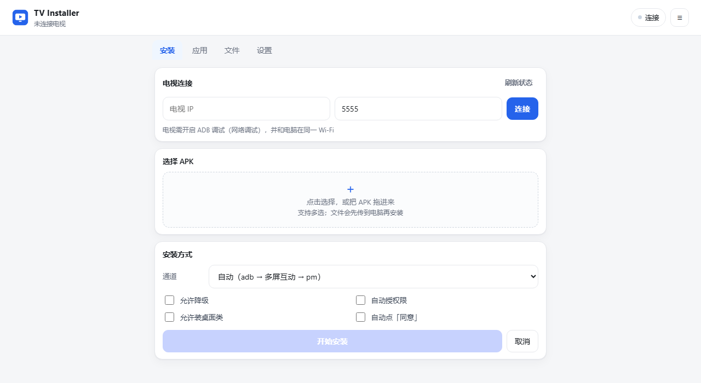
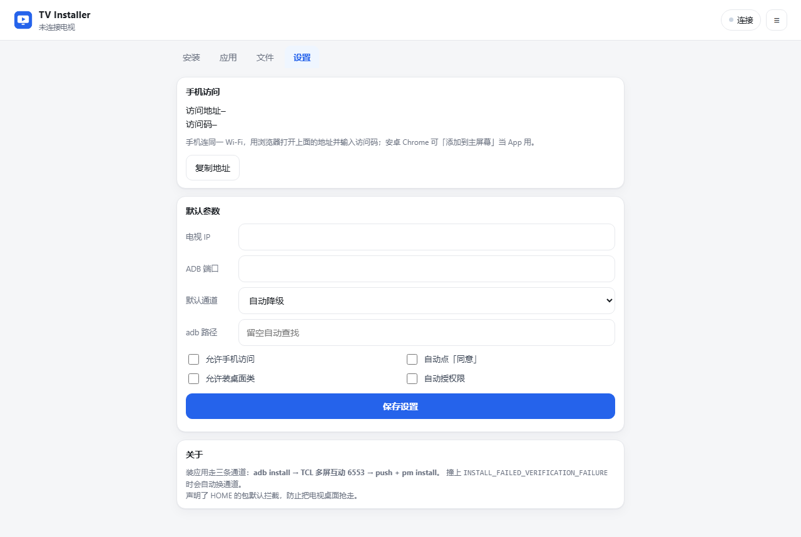

# TV Installer

[English](README.md) | **简体中文**

在电脑上给 Android TV / 电视盒子装第三方应用的本地工具。启动一个网页界面，拖入 APK 即可安装，**需要环境**（Python 3.8+ adb）。

> A local web UI for sideloading APKs to Android TV over ADB, with automatic multi-channel fallback for OEM install restrictions (TCL / 雷鸟等).

## 为什么需要它

国产电视（TCL、雷鸟等）在系统安装器里做了定制校验：安装请求会先经过 `com.android.packageinstaller` 的 verifier，再按厂商下发的策略链（TCL 上是 `InstallConfig`）逐条判断。声明了 `HOME` 的 APK、签名与当前桌面不一致的包、被列入黑名单的包，会在电视上直接提示「禁止安装」，报错是 `INSTALL_FAILED_VERIFICATION_FAILURE`。

开源社区里的同类工具（couchkit、Android-TV-Desktop-Toolkit 等）本质都是**一条 `adb install` 走天下**。`adb` 这条路确实不经过上述校验，所以它们对普通应用够用；但一旦 adb 本身走不通——签名冲突、流式安装中断、电视端只开了厂商推送通道而没开网络调试、或者你手上只有手机——它们就没有任何退路。本项目内置三条安装通道并自动降级，把「完全装不上」压缩成「慢一点但能装上」。

## 界面

<p align="center"></p>

<p align="center"></p>

> 截图是 `python server.py` 启动后的真实界面（1280 宽，未连接电视的空闲状态）。桌面与手机共用同一套页面，宽度低于 820px 时顶部标签栏会自动移到底部。

## 功能

| 模块 | 能力 |
|---|---|
| 安装 | 拖拽 / 多选 APK、批量队列、实时日志（SSE）、自动识别 **新装 / 更新 / 降级 / 重装** |
| 通道 | `adb install` → TCL 多屏互动 6553 → `push + pm install`，失败自动降级，也可手动指定 |
| 应用 | 列出第三方应用（版本号、更新时间）、启动、强制停止、清数据、卸载、导出 APK 到电脑 |
| 文件 | 浏览电视目录、上传、下载、重命名、删除、新建文件夹、**直接安装电视上已有的 APK** |
| 设置 | 默认 IP / 端口 / 通道、adb 路径、自动点「同意」、允许装桌面类、局域网访问开关 |

## 快速开始

### 前置条件

1. **Python 3.8+**（Windows 安装时勾选 `Add Python to PATH`）
2. **adb**（Android Platform Tools）。可以装 [Android SDK Platform-Tools](https://developer.android.com/studio/releases/platform-tools)，也可以直接用你已有的 adb：
   - 已加入 `PATH` → 自动识别
   - 设置了 `ANDROID_HOME` / `ANDROID_SDK_ROOT` → 自动识别
   - 都没有 → 在界面「设置」里手填 `adb.exe` 的完整路径

> **`aapt2` 不是可选项，务必装上。** 它不只负责读包名和版本号——「桌面类 APK 拦截」这条护栏完全依赖它识别 `category.HOME`。缺了 `aapt2`，解析会退化，护栏**静默失效**（装第二个桌面也不会有任何提示）。
>
> 装 Android SDK 时自带，位于 `build-tools/<版本>/aapt2.exe`，不用单独配置；也可以用 `sdkmanager "build-tools;34.0.0"` 单独装。自检方法：启动服务后看 `/api/state` 里 `aapt` 字段是否为空。

### 电视端准备

1. 电视和电脑连**同一个 Wi-Fi**
2. 打开开发者选项：设置 → 关于 → 版本号连点 5~7 次
3. 打开 **ADB 调试 / 网络调试**（不同机型叫法不同）
4. 记下电视的 IP：设置 → 网络 → 当前连接详情

### 运行

```bash
# Windows：双击
start.bat

# 或者手动
python server.py
```

浏览器会自动打开 `http://127.0.0.1:8770/`。填电视 IP → 点「连接」→ 把 APK 拖进虚线框 → 「开始安装」。

常用参数：

```bash
python server.py --port 8780     # 端口被占用时换一个
python server.py --local         # 只监听 127.0.0.1（默认行为）
python server.py --no-browser    # 不自动开浏览器
```

## 三条安装通道

| 通道 | 做法 | 经不经过电视的安装校验 | 典型场景 |
|---|---|---|---|
| `adb` | `adb install -r [-d] [-g]` | **不经过**：shell 直接提交安装会话，不触发 verifier | 首选，绝大多数第三方应用 |
| `tcast` | TCL 多屏互动（`com.tcl.MultiScreenInteraction_TV`，TCP 6553）+ `adb reverse` + 本地 HTTP 供电视拉取，自动点电视上的「同意」 | **不经过**：多屏互动自己弹确认框、自己装完，不建 `PackageInstaller` 会话 | adb 通道不可用时的替代路径 |
| `pm` | `adb push /data/local/tmp` + `pm install -r` | **不经过** | adb 流式安装异常时的兜底 |

「自动」模式按 `adb → tcast → pm` 依次尝试。日志里能看到每一步的命令、原始输出，以及中文的失败原因（签名不一致、版本降级、存储不足、架构不匹配等）。

> **`tcast` 到底是什么**：电视端的「多屏互动」是个持 `INSTALL_PACKAGES` 的系统应用——它自己画确认框，点完「同意」就自己把包装上，**不创建 `PackageInstaller` 会话**，因此不会发出验证广播、策略链根本不会跑。它能装 `adb` 或电视 UI 装不上的包，靠的是这条不同的代码路径，不是什么技巧。`adb` / `pm` 同理。（置信度：3 条一致的观察，还缺 1 次对照实验，见[踩坑记录 P-04](docs/PITFALLS.md)。）

### 关于电视的安装校验

实测结论（TCL 65T6L Pro / MT5879 / Android 11）：

- 校验链挂在 **PackageInstaller 的 verifier** 上，收到 `PACKAGE_NEEDS_VERIFICATION` 才跑，不装机就不跑
- 由 `content://com.tcl.providers.config/InstallConfig` 下发的策略链控制，按 `priority 0→5` 执行，**第一条给出结论的策略就定局**
- `launcherStrategy` 只对**声明了 `HOME` 的包**做判断，普通应用在这一层第一行就放行，走不到后面的 `pmStrategy`
- 所以「某些 app 被禁止安装」通常指的是**桌面 / 启动器类** APK，而不是普通视频应用
- `adb install` 走的是 shell 直接提交会话，**根本不触发这条 verifier**，这是它能装进去的真正原因
- 这条链的配置本身有个坑：`config_content` 必须是**JSON 数组**，写成裸对象会导致整份策略静默失效（fail-open）。排查方法见 [踩坑记录](docs/PITFALLS.md)

完整机制、源码级逻辑与实测证据见 [开发文档 §8](docs/DEVELOPMENT.md#8-背景oem-安装校验tcl-实测)。

## 安全护栏

- **桌面类拦截**：APK 声明 `android.intent.category.HOME` 时默认拒绝安装，需手动勾选「允许装桌面类」。防止误装第二个桌面导致开机弹选择框。
- **关键包保护**：`com.android.systemui`、`com.tcl.cyberui`、`com.tcl.providers.config`、`com.android.packageinstaller` 等包的卸载 / 清数据请求会被直接拒绝。自己的桌面可以用 `protected_extra` 追加保护。
- **文件操作白名单**：删除 / 改名 / 新建只允许在 `/sdcard`、`/storage`、`/mnt`、`/data/local/tmp` 下，`/system`、`/data/app` 一律拒绝。
- **只监听本机**：默认 `127.0.0.1`。需要手机访问时在「设置」里开局域网，并用 6 位访问码鉴权（改完需重启服务）。

## 目录结构

```
tv-installer/
├── server.py            HTTP 路由：静态页 + JSON API + SSE
├── core.py              配置、adb/aapt 发现、设备信息、APK 解析
├── channels.py          三条安装通道 + 错误码中文映射
├── jobs.py              安装任务队列 + 事件总线（同一时刻只跑一个任务）
├── make_icons.py        生成 PWA 图标（纯标准库画 PNG）
├── ui/                  前端：index.html / app.css / app.js / manifest / sw.js / 图标
├── docs/                开发文档、实施文档、路线图
├── config.json          本地配置（首次运行自动生成，不入库）
└── start.bat            Windows 启动脚本
```

## API

所有接口都在 `http://127.0.0.1:8770` 下，请求和响应均为 JSON（下载接口除外）。

| 方法 | 路径 | 说明 |
|---|---|---|
| GET | `/api/state` | adb / aapt 路径、设备列表与信息、设置、局域网地址 |
| POST | `/api/connect` | `{ip, port}` 连接电视 |
| POST | `/api/disconnect` | 断开当前连接 |
| POST | `/api/settings` | 更新设置（IP、端口、通道、开关、adb 路径、`protected_extra`） |
| POST | `/api/upload?name=x.apk` | 原始字节流上传 APK，返回解析结果 |
| POST | `/api/inspect` | `{path, serial}` 解析本地 APK（包名、版本、中文名、是否 HOME、与已装版本对比） |
| POST | `/api/install` | `{serial, apks:[路径], channel, allow_home, downgrade, grant}` |
| POST | `/api/install-device` | `{serial, paths:[电视上的 APK]}` 直接装电视本地 APK |
| POST | `/api/cancel` | 取消当前任务 |
| GET | `/api/events` | SSE：实时日志 + 任务进度 |
| GET | `/api/apps?serial=` | 第三方应用列表（含版本号、`protected` 标记） |
| POST | `/api/app` | `{serial, package, action: launch\|stop\|clear\|uninstall}` |
| GET | `/api/app/export?package=` | 把电视上的应用 APK 导到电脑 |
| GET | `/api/files?path=/sdcard` | 目录列表 |
| POST | `/api/files/{mkdir,rename,delete,upload}` | 文件操作（受白名单限制） |
| GET | `/api/files/download?path=` | 下载文件 |

## 配置

首次运行会在项目根目录生成 `config.json`：

```json
{
  "adb": null,
  "last_ip": "",
  "last_port": 5555,
  "channel": "auto",
  "auto_accept": true,
  "allow_home": false,
  "grant": false,
  "downgrade": false,
  "lan": false,
  "http_port": 8770,
  "pin": "由程序随机生成",
  "protected_extra": []
}
```

| 键 | 说明 |
|---|---|
| `adb` | adb 可执行文件路径，`null` 表示自动查找 |
| `channel` | `auto` / `adb` / `tcast` / `pm` |
| `auto_accept` | 多屏互动通道是否自动点电视上的「同意」 |
| `allow_home` | 是否允许安装声明 HOME 的包 |
| `grant` | 安装时是否加 `-g` 自动授予运行时权限 |
| `downgrade` | 是否允许降级安装（`-d`） |
| `lan` | 是否监听 `0.0.0.0` 供局域网（手机）访问 |
| `pin` | 局域网访问码，首次运行自动生成 |
| `protected_extra` | 额外保护、禁止卸载的包名数组 |

## 已知限制

| 限制 | 说明 | 影响 |
|---|---|---|
| 缺 `aapt2` 时护栏失效 | 无法识别 `HOME` 声明，桌面类拦截静默放行 | ⚠️ 安全相关，务必装 |
| 不内置 adb | 需本机已装 platform-tools，或在「设置」里指定路径 | 首次使用需准备 |
| `tcast` 依赖多屏互动服务 | 需电视上 `com.tcl.MultiScreenInteraction_TV` 在运行，且电视不能深度休眠 | 先唤醒再推 |
| 不支持分包 APK | `.apks` / split APK / `.xapk` 都不支持 | 部分商店提取包装不了 |
| 应用列表无中文名 | 只显示包名；安装队列里才有中文名（来自 APK 自身） | 略影响辨认 |
| 单设备、单任务 | 同一时刻只连一台电视、只跑一个安装任务 | 批量场景需排队 |
| 局域网默认关闭 | 默认只监听 `127.0.0.1`，手机访问需在设置里开启并输入访问码 | 有意为之 |

## 文档

| 文档 | 内容 | 适合谁读 |
|---|---|---|
| [开发文档](docs/DEVELOPMENT.md) | 架构、模块职责、线程模型、数据流、API 契约、OEM 校验机制、扩展指南 | 要改代码的人 |
| [实施文档](docs/DEPLOYMENT.md) | 环境准备、部署、电视端配置、验收清单、排错手册、升级卸载 | 要部署 / 排查的人 |
| [踩坑记录](docs/PITFALLS.md) | 开发与联调中真实踩过的坑，按「现象 → 根因 → 解决 → 教训」记录 | 遇到怪问题时先查这里 |
| [路线图与已知问题](docs/ROADMAP.md) | 版本规划、已发现未修复的缺陷、已规划增强、同类项目调研 | 想知道「还缺什么」的人 |
| [更新日志](CHANGELOG.md) | 每个版本改了什么 | 升级前看一眼 |

> 遇到「明明代码没改，行为却不对」的情况，先翻[踩坑记录](docs/PITFALLS.md)——里面有几条是**结论曾经写错、后来被实测推翻**的，包括 `aapt2` 缺失导致护栏失效、`InstallConfig` 格式写错导致校验整体失效、以及「`tcast` 会经过系统安装器所以也会被拦」。

## 许可

[MIT](LICENSE)
